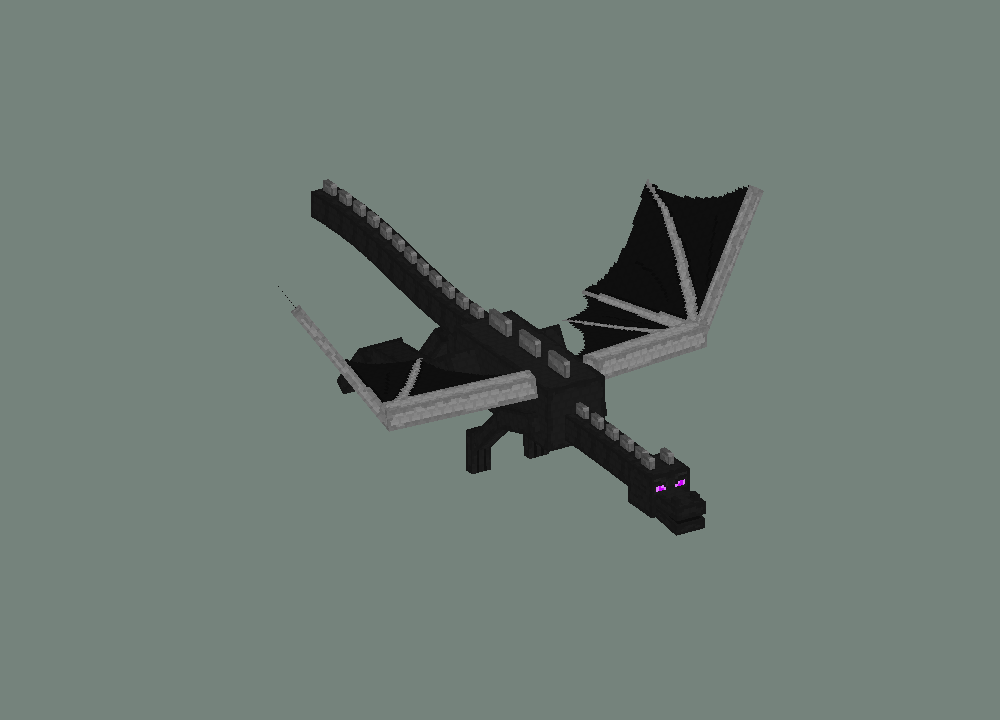

# Minecraft mobs in FiveM

Los Santos had traffic, crime, and questionable driving. We added a Creeper, a Ghast, and an Ender Dragon. Urban planning has never recovered.

Three standalone FiveM resources by [0xSacul](https://github.com/0xSacul), built for experiments, laughs, and the deeply scientific question: **"Can we put this in GTA?"**

> [!WARNING]
> **Experimental toys. Do not install these as-is on a real production server.**
> They are not production optimized, hardened, or certified for multiplayer use. Caps and cooldowns are guardrails, not a performance guarantee. Your roleplay economy does not need an unscheduled dragon incident.

## Meet the local problems

| Resource | Party trick | Spawn | Remove your mobs | Default cap: per player / server |
| --- | --- | --- | --- | --- |
| [fivem-creeper](fivem-creeper/README.md) | Ground pursuit, four animated legs, a hiss, and regrettable proximity | `/creeper` | `/creeperclear` | 2 / 8 |
| [fivem-ghast](fivem-ghast/README.md) | Flying, crying, fireballs, and approximate melee reflection | `/ghast` | `/ghastclear` | 1 / 6 |
| [fivem-enderdragon](fivem-enderdragon/README.md) | Animated flight, swoops, breath clouds, and vehicle contact explosions | `/enderdragon` | `/enderdragonclear` | 1 / 2 |

Each resource runs independently. Use one, two, or all three if your test session needs consequences. They do not share mob combat or simulate a complete Minecraft ecosystem.

<details>
<summary>A dragon, for science</summary>



This is an **offline geometry reference**, not an in-game capture or a performance demonstration.

</details>

## Optimization: the elephant is actually a dragon

**This project prioritizes making the mobs exist and behave recognizably. It does not establish that this is a sensible way to run them at scale.** There are no published FPS, resource-time, bandwidth, or player-count benchmarks. "Works in a small experiment" is not a capacity plan.

The visible mobs are procedural textured triangles, animated in Lua around invisible local object anchors. They are not rigged, streamed GTA models. Every nearby client draws its own copy.

| Where the work goes | What the prototype does | What scaling would need |
| --- | --- | --- |
| Rendering and allocations | Transforms geometry and submits individual triangle draws every frame. A Creeper draws 72 triangles; a Ghast draws 120. The dragon's base mesh draws 748, plus its eye overlay, projectiles, and breath. Temporary Lua tables add garbage-collection pressure. | Profile native draw overhead and allocations; investigate rigged native drawables, cached buffers/transforms, LODs, and visibility culling. |
| Simulation and targeting | Owner clients simulate movement. Target scans run at intervals, but scan the streamed ped pool; movement, LOS, collision probes, and combat checks add work. Dragon contact scans inspect nearby vehicles and posed hitboxes. | Share/cache candidate lists, add a spatial broad phase, budget collision work, and separate simulation frequency from rendering. |
| Networking | Owners send state every 100 ms. The server relays it within the routing bucket; clients request snapshots every 3 seconds. **Bucket isolation is not distance-based interest management.** | Measure bandwidth and server dispatch cost, scope recipients by interest, reduce redundant data, and design ownership migration. |
| Audio and effects | Each resource has its own hidden Web Audio page, caches decoded sounds, and caps voices. Fireballs, fires, and breath clouds still add entities/effects and collision/damage work. | Profile the combined workload, reuse effects, and manage voice/projectile/cloud budgets across resources. |

There are useful limits already: mob and projectile caps, spawn cooldowns, target-scan intervals, render distances, bounded audio voices, and cleanup on removal/resource stop. These help keep a test session contained. **Render distance stops drawing; it does not eliminate all simulation, replicas, or network traffic.** The client loops still run every frame even with no mobs active.

For a local experiment, start with **one mob**, leave debug drawing off, lower caps and render distances, and measure with FiveM's resource monitor (`resmon 1`) and profiler. Compare idle, one mob, the configured caps, and all three resources together. Repeat with multiple clients, owner disconnects, routing-bucket changes, and streamed vehicles/NPCs. Record the actual hardware and scene. A screenshot of a dragon is not a benchmark, even if the dragon looks very convincing.

Before any production adaptation, expect substantial rendering, simulation, networking, and trust-boundary work. Lowering a config value does not magically complete that work. Optimization contributions are welcome; bring measurements and a reproducible scenario.

## Try it on a disposable test server

Requires a modern FiveM server with **OneSync enabled**. No ESX, QBCore, ox_lib, external sound resource, or npm packages are required to run the mobs. Python, Node, and a LuaJIT library are development tools only.

1. Clone or download this repository.
2. Copy the three resource folders into your server's resources directory, for example:

   ```text
   resources/
     [minecraft]/
       fivem-creeper/
       fivem-ghast/
       fivem-enderdragon/
   ```

3. Keep those resource folder names. In the **server console**, start the ones you want:

   ```text
   refresh
   ensure fivem-creeper
   ensure fivem-ghast
   ensure fivem-enderdragon
   ```

4. Go outdoors, use a spawn command from the table, and enjoy the questionable decision. Clear commands remove **your own** mobs. To end everyone's experiment, stop the corresponding resource from the server console.

For automatic startup on your test server, add the desired `ensure` lines to `server.cfg`. The root repository is a container for three resources; do not `ensure fivem-minecraft-mobs`.

Each resource's `shared/config.lua` contains tuning. **Spawn permissions are unrestricted by default** (`RequireAce = false`). To limit a shared test session, set `RequireAce = true` in each resource and grant the corresponding ACE to an existing group:

```cfg
add_ace group.admin creeper.spawn allow
add_ace group.admin ghast.spawn allow
add_ace group.admin enderdragon.spawn allow
```

ACE restrictions control who can spawn. They do not make the gameplay or networking production safe.

> [!CAUTION]
> **The dragon destroys vehicles on contact by default, including occupied vehicles.** Its contact handler makes controlled vehicles damageable; GTA explosions can hurt occupants and bystanders. Set `Config.VehicleContact.Enabled = false` in `fivem-enderdragon/shared/config.lua` if your test should spare the parking lot. Creeper explosions, Ghast fireballs/fires, and dragon breath also cause damage.

## Prototype boundaries

- **Fixed owner:** the spawning client simulates its group. Disconnects, timeouts, or routing-bucket changes remove it; there is no host migration.
- **Client trust:** the server checks things like ownership, buckets, caps, positions, and cooldowns, but client-reported hits, LOS, and contacts remain prototype inputs. This is not an anti-cheat solution.
- **Approximate combat and collision:** scripted hitboxes and swept traces replace native mob meshes. No full weapon ballistics, native skeletal collision, or Minecraft navigation/boss simulation. Wings and tails can clip scenery.
- **Limited visibility:** AI targets peds streamed to its owner. Local replicas and anchors may conflict with strict entity-lockdown setups.
- **Validation limits:** mocked automated checks exercise logic and assets. They do not prove actual FiveM rendering, audio, collision, multiplayer reliability, or production performance.

The resource READMEs document the individual behaviors and limitations. [DEVELOPMENT.md](DEVELOPMENT.md) explains the existing checks and extraction tools.

## License and asset credits

Original project code is released under the [MIT license](LICENSE). **That license does not grant rights to Minecraft assets or Minecraft-derived reference/model data.** Bundled textures, sounds, compiled Java reference classes, and derived material retain their original ownership. See [THIRD_PARTY_NOTICES.md](THIRD_PARTY_NOTICES.md) and each resource's `assets/SOURCES.md` / `assets/provenance.json` for the scope and recorded sources.

This is an unofficial fan experiment, unaffiliated with Mojang, Microsoft, Rockstar Games, or Cfx.re. Review the applicable asset permissions before reusing or redistributing those materials.

Have fun. Back up the test server. Do not let the Creeper write your incident report.
